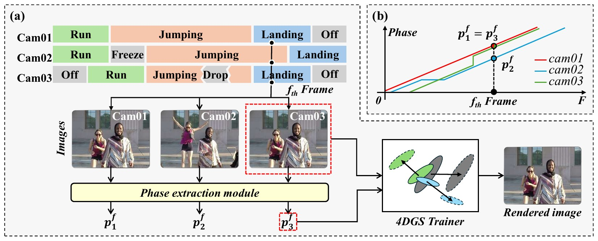

# Phase-DGS: Phase-guided Dynamic Gaussian Splatting from Unsynchronized Multi-view Video

[**NeurIPS 2026**](https://neurips.cc/virtual/2026/loc/sydney/poster/154774) · [Project page](https://oc-dev74.github.io/Phase-DGS/) · Paper (coming soon) · Code (coming soon)

Hosung Jeon<sup>†1</sup>, Jun Young Jeong<sup>1</sup>, Sangwoon Kwak<sup>†1</sup>, Joonsoo Kim<sup>1</sup>, Sangmin Kim<sup>2</sup>, Jaesik Park<sup>2</sup>, Won-Sik Cheong<sup>1</sup>, Hyon-Gon Choo<sup>1</sup>

<sup>1</sup>Electronics and Telecommunications Research Institute (ETRI) · <sup>2</sup>Seoul National University · <sup>†</sup>Co-corresponding authors



Dynamic Gaussian Splatting assumes that every camera captures the scene at the same instant. Phase-DGS removes this assumption: it replaces the timestamp of each frame with a phase estimated from the image itself, so frames that show the same motion state share the same phase regardless of which camera recorded them or when. This lets 4D Gaussian Splatting be trained from unsynchronized multi-view video with temporal offsets, frame drops, and camera freezes, and it plugs into existing backbones such as RealTime-4DGS and FreeTimeGS without modifying them.

## News

- Phase-DGS has been accepted to NeurIPS 2026 as a poster.
- Code will be released soon.

## About this repository

This repository currently hosts the project page (`index.html` and `static/`), published with GitHub Pages at <https://oc-dev74.github.io/Phase-DGS/>.

## Citation

```bibtex
@inproceedings{jeon2026phasedgs,
  title     = {Phase-DGS: Phase-guided Dynamic Gaussian Splatting
               from Unsynchronized Multi-view Video},
  author    = {Jeon, Hosung and Jeong, Jun Young and Kwak, Sangwoon and
               Kim, Joonsoo and Kim, Sangmin and Park, Jaesik and
               Cheong, Won-Sik and Choo, Hyon-Gon},
  booktitle = {Advances in Neural Information Processing Systems (NeurIPS)},
  year      = {2026}
}
```

## Acknowledgements

The project page is built from the [Academic Project Page Template](https://github.com/eliahuhorwitz/Academic-project-page-template).
