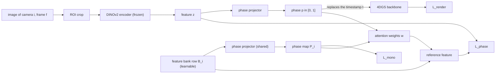

# Phase-DGS

**Phase-DGS: Phase-guided Dynamic Gaussian Splatting from Unsynchronized Multi-view Video** (NeurIPS 2026)

[Project page](https://oc-dev74.github.io/Phase-DGS/) · [Paper (arXiv)](https://arxiv.org/abs/2611.04666) · [NeurIPS 2026](https://neurips.cc/virtual/2026/loc/sydney/poster/154774)

Hosung Jeon, Jun Young Jeong, Sangwoon Kwak, Joonsoo Kim, Sangmin Kim, Jaesik Park, Won-Sik Cheong, Hyon-Gon Choo
(ETRI, Seoul National University)

Phase-DGS trains a 4D Gaussian Splatting (4DGS) model from multi-view videos whose cameras are **not synchronized** (temporal offsets, frame drops, frame freezes).
Instead of the timestamp of a frame, the 4DGS backbone receives a **phase** $p \in [0, 1]$ extracted from the image itself, so frames that show the same motion state share the same time coordinate regardless of which camera captured them or when.

This repository contains the backbone-agnostic **Phase-DGS module** (`phase_dgs/`): the phase extraction module, the feature bank, the losses, and helpers to attach them to a 4DGS training loop and to evaluate a trained model.
It also contains the ROI selection tool and the generators of the Synced / Shifted / Dropped datasets used in the paper.
The 4DGS backbones (FreeTimeGS, RealTime-4DGS) are **not** included; [Integration with a 4DGS backbone](#integration-with-a-4dgs-backbone) explains how to plug Phase-DGS into one.

This is a cleaned-up release of the research code used for the paper.
It was reorganized and commented for the public release with the help of an AI coding assistant, and then reviewed and tested by the authors.
Results may differ slightly from the numbers in the paper (see [Evaluation](#evaluation)).

## Method



1. **Phase extraction (Sec. 3.2).** The image $u_i^f$ of camera $i$ and frame $f$ is cropped to a motion-intensive region of interest (ROI), resized to the ViT input size and encoded by a frozen DINOv2 encoder.
   Its patch tokens are averaged into a global feature $z_i^f \in \mathbb{R}^d$ (Eq. 1); `ratio_CLS` in `SyncConfig` can blend in the CLS token, and the paper uses `ratio_CLS = 0`.
   A phase projector MLP $\Phi$ ($d \to 256 \to 128 \to 64 \to 1$, GELU, sigmoid) maps it to the phase $p_i^f = \Phi(z_i^f) \in [0, 1]$.
   The projector gets no phase labels; it is trained only by the losses below.
2. **Feature bank (Sec. 3.3).** A learnable tensor $\mathcal{B} \in \mathbb{R}^{I \times (F k) \times d}$ stores reference features of the $I$ train cameras over the $F$ frames, upsampled by a factor $k$.
   It is initialized with the features of all train frames, with linear interpolation between neighboring frames for the upsampled entries (App. A), and is optimized together with the projector.
3. **Losses (Sec. 3.4).**

   $$\mathcal{L} = \lambda _{phase} \mathcal{L} _{phase} + \lambda _{mono} \mathcal{L} _{mono} + \lambda _{render} \mathcal{L} _{render}$$

   - $\mathcal{L}_{phase}$ (phase consistency): the bank row of the image's camera is mapped to a phase map $\mathcal{P}_i = \Phi(\mathcal{B}_i)$.
     The entries whose phase is close to $p_i^f$ give the reference feature, which must match $z_i^f$:

     $$w = \mathrm{softmax}\left(-\left|\mathcal{P}_i - p_i^f\right|\right), \qquad \hat{z}_i^f = \sum w \cdot \mathcal{B}_i, \qquad \mathcal{L} _{phase} = \mathrm{MSE}\left(z_i^f, \hat{z}_i^f\right)$$

   - $\mathcal{L}_{mono}$ (monotonic): every phase map must increase by at least $1/(Fk)$ per entry:

     $$\mathcal{L}_{mono} = \sum_i \sum_f \mathrm{relu}\left(\frac{1}{Fk} - \left(\mathcal{P}_i^{f+1} - \mathcal{P}_i^{f}\right)\right)$$

   - $\mathcal{L}_{render}$: the rendering loss of the backbone.
4. **Training (Sec. 3.5, 3.6).** Each iteration samples one train image, extracts its phase and renders the backbone at that phase instead of the timestamp, $\mathcal{G}(p_i^f) \leftarrow \mathcal{G}(t)$.
   The three losses are back-propagated together, so the projector is also trained through the renderer.
   The DINOv2 encoder stays frozen.
   At inference the backbone is rendered directly at a given phase, so rendering costs the same as the backbone alone; the trained projector is only used to obtain the phases (below).
5. **Evaluation (App. B, Algorithm 1).** Test views are not used for training, so each test frame is rendered at a reference phase: the mean phase of the train-view frames captured from the same source frame.
   The source frames come from the frame map written by the dataset generators.

## Repository layout

```
phase_dgs/                    Phase-DGS module
  extractor.py                ROI crop, frozen DINOv2 encoder, phase projector (Sec. 3.2)
  feature_bank.py             feature bank and its initialization (Sec. 3.3, App. A)
  losses.py                   L_phase, L_mono (Sec. 3.4)
  phase_sync.py               PhaseSync: attaches the modules to a 4DGS training loop (Sec. 3.6)
  checkpoint.py               loads trained modules from <run>/model_sync/
  inference.py                reference phases for evaluation (Algorithm 1), phases for rendering (App. C)
  plot.py                     phase graph: phase map of the feature bank + per-frame phases
  config.py                   SyncConfig (Phase-DGS settings)
configs/sync.toml             Phase-DGS settings (the defaults of SyncConfig)
tools/select_roi.py           GUI for the per-camera ROIs -> roi.json (App. A)
tools/make_full_frame_roi.py  roi.json without cropping
Prepare_dataset_phaseDGS/     Synced / Shifted / Dropped dataset generators (Sec. 4.1, App. A)
```

The 4DGS backbones are not part of this repository.
4DGaussians (RealTime-4DGS) is cloned next to it ([Setup](#setup)); a FreeTimeGS implementation is not included, so use your own and apply the changes in [FreeTimeGS](#freetimegs).

## Setup

Clone this repository and the backbone side by side in one working folder.
4DGaussians is only needed to use RealTime-4DGS as the backbone (see [RealTime-4DGS](#realtime-4dgs)); for FreeTimeGS, put your own implementation in its place.

```shell
mkdir workspace && cd workspace
git clone https://github.com/OC-DEV74/Phase-DGS.git             # this repository
git clone --recursive https://github.com/hustvl/4DGaussians.git  # backbone (with its submodules)
```

After data preparation and training, the working folder looks like this (`datasets/` is in `.gitignore`):

```
workspace/
├── Phase-DGS/                         this repository (pip install -e .)
│   ├── configs/sync.toml
│   └── datasets/<scene>/              one generated condition, e.g. datasets/jumping_dropped/
│       ├── 0000.mp4, 0001.mp4, ...    camera c = c-th video in sorted name order
│       ├── roi.json
│       └── info/frame_map.json        needed for evaluation
└── <backbone>/                        the backbone; its train.py runs from here
```

Relative paths in this README (`configs/...`, `datasets/<scene>/...`) start at this repository.
Code that runs from the backbone's folder needs absolute paths, including `roi_json` in the config.

## Installation

Python 3.11 or newer and PyTorch are required (tested with Python 3.12, PyTorch 2.8 and CUDA 12.8).
Install everything, including the backbone, into one virtual environment; the system Python of recent Ubuntu refuses `pip install`.

```shell
# in workspace/ (Ubuntu: sudo apt install python3-venv)
python3 -m venv .venv && source .venv/bin/activate
pip install torch torchvision --index-url https://download.pytorch.org/whl/cu128   # PyTorch for your CUDA, see pytorch.org

cd Phase-DGS
pip install -e .            # phase_dgs
pip install -e ".[tools]"   # also tools/ and Prepare_dataset_phaseDGS/ (select_roi.py also needs tkinter)
```

Install the backbone into the same virtual environment, following its own instructions:

```shell
cd ../<backbone>
# install the backbone here, in the same virtual environment
```

DINOv2 is downloaded through `torch.hub` the first time a phase extractor is built.

## Data preparation

### Datasets

The generators turn synchronized multi-view videos into the conditions of the paper.
They read `source_video/<scene>/` (one video per camera; the camera order is the sorted file name order) and write the videos of a condition together with `info/frame_map.json`, which records the source frame of every output frame.
Evaluation needs this file.

```shell
cd Prepare_dataset_phaseDGS

# Synced: same frame range for every camera
python make_synced.py  --scene nvidia-jumping

# Shifted: random start offset per camera
python make_shifted.py --scene nvidia-jumping --max_offset 20 --seed 42

# Dropped: offset + random frame drops + dropped frame blocks, per camera as set in
# config/<scene>_config.json (a default config is written on the first run)
python make_dropped.py --scene nvidia-jumping --seed 42

# optional: frame map plot and grid video of every generated condition
python visualization.py --scene nvidia-jumping --plot_frame_map --grid_video
```

The output is `output/<scene>/<condition>/{<camera>.mp4, info/frame_map.json, info/summary.txt}`.
`config/` holds the Dropped settings of the scenes in the paper.
Copy (or link) one generated condition to `datasets/<scene>/`, the folder the steps below use, e.g. `cp -r Prepare_dataset_phaseDGS/output/nvidia-jumping/dropped datasets/jumping_dropped`.

### ROIs

```shell
python tools/select_roi.py                               # GUI, writes <video folder>/roi.json
python tools/make_full_frame_roi.py datasets/<scene>/    # or no cropping
```

In `select_roi.py`, select the video folder of a scene, place one box per camera ("Sync All Boxes" moves all boxes together, "Default Setting" uses the largest centered square, "Full Frame" disables cropping) and press "Export JSON".
`roi.json` stores the ViT input size and one box per video, in pixels of the original videos:

```json
{"input_size": 224, "rois": {"0000.mp4": {"x": 640, "y": 220, "width": 640, "height": 640}, "...": {}}}
```

The ROI crop is optional; without it the full frame is resized to the ViT input (paper Sec. 4.5).

**Camera index.** Throughout `phase_dgs`, the index of a camera is the position of its video in the sorted file names of `roi.json`, which is also the camera order of the dataset generators.
The backbone must use the same camera order.

## Usage

### Training

`PhaseSync` holds the phase extractor, the feature bank and their optimizer.
Backbone-side calls (`sample_train_image`, `backbone.*`) are placeholders.

```python
from phase_dgs import PhaseSync, SyncConfig

config = SyncConfig.from_toml("configs/sync.toml")   # or SyncConfig(roi_json="datasets/<scene>/roi.json")
sync = PhaseSync(config, train_rgb, train_cameras, scale=0.5)
# train_rgb:     (F, I, H, W, 3) uint8 frames of the I train cameras (may stay on the CPU)
# train_cameras: camera index of each of the I columns
# scale:         training resolution / original video resolution (the ROIs are scaled by it)

for it in range(num_iterations):
    camera, frame, gt = sample_train_image()             # one train image per iteration, gt: (H, W, 3) uint8 on the GPU

    phases, features = sync.phases(gt[None], [camera])   # (1, 1) phase, (1, d) feature
    t = phases[0, 0]                                     # the phase replaces the timestamp (Eq. 9)

    pred = backbone.render(camera, t)                    # keep t a tensor: L_render also trains the projector
    loss = backbone.loss(pred, gt, t)                    # L_render (+ backbone regularizers)
    loss = loss + sum(sync.losses(features, phases, [camera]).values())  # + λ_phase L_phase + λ_mono L_mono
    loss.backward()

    backbone.optimizer_step()                            # step + zero_grad of the backbone
    sync.step()                                          # step + zero_grad of the projector and the feature bank

    if it % plot_every == 0:                             # optional: phase graph of all cameras
        sync.plot(all_rgb, all_cameras, f"{run_dir}/phase_graphs/phase_{it:06d}.png", title=f"(iter {it})")

sync.save(f"{run_dir}/model_sync")                       # weights + the settings they were trained with
```

`config.enabled` is not read by `phase_dgs`; check it in your training loop to train the backbone with timestamps instead (baseline).

### Evaluation

Each test frame is rendered at its reference phase (Algorithm 1):

```python
from phase_dgs import (
    load_frame_map, load_roi_camera_names, load_trained_config, load_trained_extractor, reference_phases,
)

config, scale = load_trained_config(run_dir)                 # settings saved with the run by sync.save
extractor = load_trained_extractor(config, run_dir, scale)   # reads <run_dir>/model_sync/
phases = reference_phases(
    extractor=extractor,
    rgb=all_rgb,                                       # (F, C, H, W, 3) uint8 frames of all cameras
    test_frames=[(test_camera, f) for f in range(F)],  # (camera, video frame) of each test image
    train_cameras=train_cameras,
    camera_names=load_roi_camera_names(config.roi_json),
    frame_map=load_frame_map("datasets/<scene>/info/frame_map.json"),
)
# render test image j at phases[j] and compare it with the ground truth
```

If no train view contains the source frame of a test frame, `reference_phases` raises an error unless `fallback_times` (e.g. the test frame timestamps) is given.
The paper's metrics are computed after a small test-time phase search and only inside dynamic-region masks (App. B).
Neither is part of this repository, so its metrics are not directly comparable with the paper's tables.

### Rendering a video

A video is rendered at the phases of one reference camera (paper App. C), smoothed by a moving average (`smooth_phases`, 25 frames by default; this smoothing is not described in the paper):

```python
from phase_dgs import camera_phases, smooth_phases

phases = smooth_phases(camera_phases(extractor, all_rgb[:, ref_camera], ref_camera))
# render frame j at phases[j], from the reference camera or any other trajectory
```

## Integration with a 4DGS backbone

Phase-DGS changes only the time input and the loss of a backbone:

| | Backbone | Backbone + Phase-DGS |
|---|---|---|
| time input of a train image | timestamp of its frame | phase of the image (a tensor with gradient) |
| loss | L_render | L_render + λ_phase L_phase + λ_mono L_mono |
| train images per iteration | any | 1 |
| optimizers | backbone | backbone + `PhaseSync.step()` (projector, feature bank) |
| time input of a test image | timestamp | reference phase (Algorithm 1) |

Steps for any backbone:

1. **Time range.** The phase lies in $[0, 1]$. Normalize the time axis of the backbone to $[0, 1]$ so that the temporal parameters it initializes from frame timestamps (e.g. the time centers of Gaussians) lie in the phase range.
   For a backbone with time range $[t_0, t_1]$, use $t = t_0 + p (t_1 - t_0)$ instead.
2. **Gradient path.** Pass the phase tensor itself wherever the renderer uses the timestamp.
   Converting it to a number (`.item()`, `float(...)`, `torch.tensor(...)`) cuts the rendering gradient to the projector.
3. **One image per iteration**, since every image has its own phase.
4. **Camera order.** Use the camera indices of `roi.json` (sorted video names); they select the ROI and the feature bank row of an image.
5. **Time-dependent regularizers.** If a regularizer of the backbone takes the timestamp (e.g. the 4D regularization of FreeTimeGS), pass it the phase too.
6. **Evaluation.** Render test views at the phases of `reference_phases` instead of their timestamps.
   A PSNR computed with timestamps during training is only a progress indicator.

### FreeTimeGS

FreeTimeGS (Wang et al., CVPR 2025) models motion explicitly.
Each Gaussian has a position $\mu_x$, a time center $\mu_t$, a duration $s$ and a velocity $v$; at time $t$ it is rendered at

$$\mu_x(t) = \mu_x + v (t - \mu_t), \qquad \sigma(t) = \sigma \cdot \exp\left(-\frac{1}{2}\left(\frac{t - \mu_t}{s}\right)^2\right)$$

where $\sigma$ is its opacity.
With Phase-DGS, $t = p_i^f$.
Both expressions are differentiable in $t$, so the rendering loss reaches the projector without other changes.
The 4D regularization loss of FreeTimeGS, which evaluates the temporal opacity at $t$, also receives the phase.

Settings: time normalized to $[0, 1]$; as in the paper, 500k iterations, $k = 2$ (`FB_upsample_factor = 1`), $\lambda_{mono} = 0.1$.

### RealTime-4DGS

RealTime-4DGS (Wu et al., CVPR 2024, [hustvl/4DGaussians](https://github.com/hustvl/4DGaussians)) models motion implicitly: a deformation field (HexPlane + MLP) predicts the change of position, rotation and scale of each Gaussian from its position and the time $t$.

**Data.** With 4DGaussians installed as in [Installation](#installation), convert the scene to its multipleview format (`data/multipleview/<scene>/cam01/frame_00001.jpg`, ..., then `multipleviewprogress.sh`; see its README).
Keep the camera order (`0000.mp4` → `cam01`, `0001.mp4` → `cam02`, ...) and extract the frames at the training resolution (e.g. 960×540 for `scale=0.5`).

The changes to the official code (commit `843d5ac`) are shown as diffs (`-` removed, `+` added, other lines unchanged, `...` skipped lines):

1. **`gaussian_renderer/__init__.py`, `render()`**: add an argument `phase=None` and use it as the time input of the deformation field.
   The original line goes through `torch.tensor(...)`, which detaches its input, so the phase must bypass it:

   ```diff
    from time import time as get_time
   -def render(viewpoint_camera, pc : GaussianModel, pipe, bg_color : torch.Tensor, scaling_modifier = 1.0, override_color = None, stage="fine", cam_type=None):
   +def render(viewpoint_camera, pc : GaussianModel, pipe, bg_color : torch.Tensor, scaling_modifier = 1.0, override_color = None, stage="fine", cam_type=None, phase=None):
        """
    ...
                debug=pipe.debug
            )
   -        time = torch.tensor(viewpoint_camera.time).to(means3D.device).repeat(means3D.shape[0],1)
   +        if phase is None:
   +            time = torch.tensor(viewpoint_camera.time).to(means3D.device).repeat(means3D.shape[0],1)
   +        else:
   +            time = phase.reshape(1, 1).expand(means3D.shape[0], 1)
        else:
            raster_settings = viewpoint_camera['camera']
   ```

2. **`train.py`, `training()`**: read the config given by `--sync_config` right after `scene = Scene(...)`.
   If its `enabled` is true, build `PhaseSync` once from the train frames; otherwise `sync` stays `None` and the backbone trains with timestamps (baseline).
   Pass `sync` to both `scene_reconstruction()` calls (coarse and fine), and after the fine stage save it and draw its phase graph.
   `camera_frame` maps an image path of the multipleview loader to its camera and frame (`cam01` is camera 0 of `roi.json`):

   ```diff
    import copy
   +import re
   +from PIL import Image
   +from phase_dgs import PhaseSync, SyncConfig
   +
   +
   +def camera_frame(path):  # ".../cam01/frame_00001.jpg" -> (0, 0)
   +    m = re.search(r"cam(\d+)[/\\]frame_(\d+)", path)
   +    return int(m.group(1)) - 1, int(m.group(2)) - 1
    
    to8b = lambda x : (255*np.clip(x.cpu().numpy(),0,1)).astype(np.uint8)
    ...
        scene = Scene(dataset, gaussians, load_coarse=None)
   +    config = SyncConfig.from_toml(args.sync_config)  # roi_json in it: absolute path
   +    sync = None  # enabled = false: train the backbone with timestamps (baseline)
   +    if config.enabled:
   +        paths = scene.train_camera.dataset.image_paths  # train frames (F, I, H, W, 3) uint8
   +        images = {camera_frame(p): np.array(Image.open(p).convert("RGB")) for p in paths}
   +        train_cameras = sorted({c for c, _ in images})
   +        frames = sorted({f for _, f in images})
   +        train_rgb = torch.from_numpy(np.stack([[images[c, f] for c in train_cameras] for f in frames]))
   +        del images
   +        sync = PhaseSync(config, train_rgb, train_cameras, scale=0.5)
        timer.start()
        scene_reconstruction(dataset, opt, hyper, pipe, testing_iterations, saving_iterations,
                                 checkpoint_iterations, checkpoint, debug_from,
   -                             gaussians, scene, "coarse", tb_writer, opt.coarse_iterations,timer)
   +                             gaussians, scene, "coarse", tb_writer, opt.coarse_iterations,timer, sync)
        scene_reconstruction(dataset, opt, hyper, pipe, testing_iterations, saving_iterations,
                             checkpoint_iterations, checkpoint, debug_from,
   -                         gaussians, scene, "fine", tb_writer, opt.iterations,timer)
   +                         gaussians, scene, "fine", tb_writer, opt.iterations,timer, sync)
   +    if sync is not None:
   +        sync.save(os.path.join(scene.model_path, "model_sync"))
   +        sync.plot(train_rgb, train_cameras, os.path.join(scene.model_path, "phase_graph.png"))
    ...
        parser.add_argument("--configs", type=str, default = "")
   +    parser.add_argument("--sync_config", type=str, default = "/abs/path/to/Phase-DGS/configs/sync.toml")
   ```

3. **`train.py`, `scene_reconstruction()`**: take `sync`; when it is set, extract the phase of each camera's ground-truth image right before `render(...)`, render at it, and add the Phase-DGS losses before `loss.backward()`.
   Without it, `render()` uses the timestamp and no loss is added:

   ```diff
                             checkpoint_iterations, checkpoint, debug_from,
   -                         gaussians, scene, stage, tb_writer, train_iter,timer):
   +                         gaussians, scene, stage, tb_writer, train_iter,timer, sync=None):
        first_iter = 0
    ...
            viewspace_point_tensor_list = []
   +        sync_loss = 0
            for viewpoint_cam in viewpoint_cams:
   -            render_pkg = render(viewpoint_cam, gaussians, pipe, background, stage=stage,cam_type=scene.dataset_type)
   +            phase = None  # without Phase-DGS: the timestamp of the camera
   +            if sync is not None:
   +                gt = (viewpoint_cam.original_image.permute(1, 2, 0) * 255).round().byte()[None].cuda()  # (1, H, W, 3) uint8
   +                camera = camera_frame(scene.train_camera.dataset.image_paths[viewpoint_cam.uid])[0]
   +                phases, features = sync.phases(gt, [camera])
   +                sync_loss = sync_loss + sum(sync.losses(features, phases, [camera]).values())
   +                phase = phases[0, 0]
   +            render_pkg = render(viewpoint_cam, gaussians, pipe, background, stage=stage,cam_type=scene.dataset_type, phase=phase)
    ...
   +        loss = loss + sync_loss
            loss.backward()
   ```

4. **`train.py`, optimizer step**: step the Phase-DGS modules together with the Gaussians:

   ```diff
                if iteration < opt.iterations:
                    gaussians.optimizer.step()
                    gaussians.optimizer.zero_grad(set_to_none = True)
   +                if sync is not None:
   +                    sync.step()
   ```
5. **Config file** (e.g. `arguments/multipleview/<scene>.py`): set `batch_size = 1` and `iterations = 60000` in `OptimizationParams`.
   Values set in the config file override the command line, so `--iterations` is ignored when the config file sets `iterations`.
6. **Evaluation**: `render()` uses the camera timestamp unless a phase is given.
   Render each test view at its reference phase, `render(view, ..., phase=torch.tensor(p, device="cuda"))` with `p` from `reference_phases`, e.g. in `render_set()` of `render.py`.
   The test PSNR printed during training uses the timestamps.
   The multipleview loader (`scene/multipleview_dataset.py`) trains on every camera and takes its test views from the same cameras; to evaluate on held-out cameras as in the paper, remove them from its train split.

Settings of the paper: 60k iterations, $k = 3$, $\lambda_{mono} = 0.01$.
This backbone starts to overfit after about 60k iterations (App. C).

### Hyperparameters

| Setting | FreeTimeGS | RealTime-4DGS |
|---|---|---|
| ViT encoder | `dinov2_vitb14` | `dinov2_vitb14` |
| Feature z | mean of the patch tokens (`ratio_CLS = 0`) | mean of the patch tokens (`ratio_CLS = 0`) |
| Phase projector | d → 256 → 128 → 64 → 1 | d → 256 → 128 → 64 → 1 |
| Learning rate (projector / feature bank) | 1e-4 / 1e-3 | 1e-4 / 1e-3 |
| λ_render / λ_phase | 1.0 / 0.1 | 1.0 / 0.1 |
| λ_mono | 0.1 | 0.1 |
| Upsampling factor k | 1 | 1 |
| Iterations | 500k | 60k |
| Train images per iteration | 1 | 1 |

The defaults of `SyncConfig` are $k = 1$ and $\lambda_{mono} = 0.1$; set `FB_upsample_factor` and `lambda_mono` for your backbone.

## Citation

```bibtex
@inproceedings{jeon2026phasedgs,
  title     = {Phase-DGS: Phase-guided Dynamic Gaussian Splatting from Unsynchronized Multi-view Video},
  author    = {Jeon, Hosung and Jeong, Jun Young and Kwak, Sangwoon and Kim, Joonsoo and Kim, Sangmin and Park, Jaesik and Cheong, Won-Sik and Choo, Hyon-Gon},
  booktitle = {Advances in Neural Information Processing Systems (NeurIPS)},
  year      = {2026}
}
```

## License

This code is released under the [MIT License](LICENSE).
DINOv2 is downloaded through `torch.hub` under its own license (Apache 2.0) and is not part of this repository.
The diffs in [RealTime-4DGS](#realtime-4dgs) quote and modify lines of [hustvl/4DGaussians](https://github.com/hustvl/4DGaussians) (commit `843d5ac`), which is released under the Apache License 2.0.
The 4DGS backbones and their dependencies are installed separately under their own licenses; for example, the Gaussian rasterizer used by 4DGaussians is under Inria's Gaussian-Splatting License, which allows only non-commercial use (research and evaluation).
